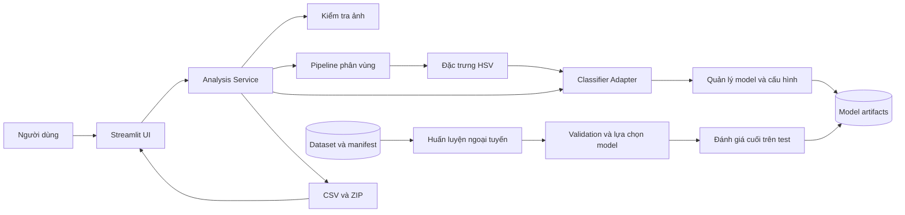
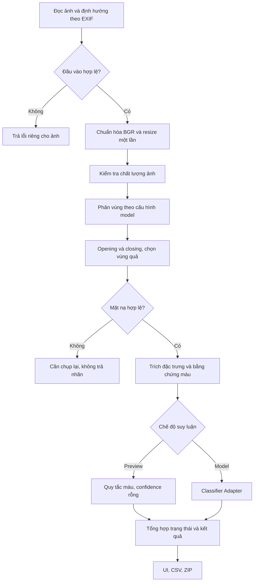
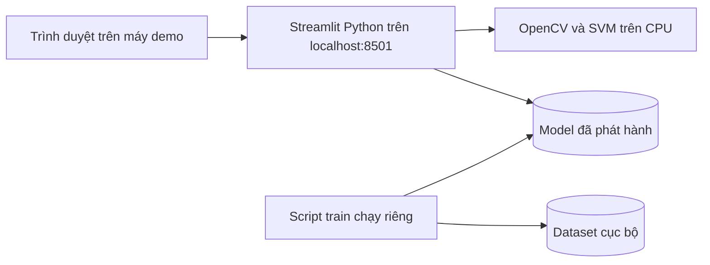

# Kiến trúc FreshLens

Ngày cập nhật: 02/11/2026. Tài liệu mô tả **kiến trúc hoàn chỉnh của FreshLens** và đối chiếu với mã nguồn thực tế. Các dịch vụ điều phối, hợp đồng dữ liệu, quản lý mô hình (SVM + CNN adapter), kiểm tra chất lượng và xuất kết quả đã được triển khai đầy đủ. Đọc [HANDOFF.md](HANDOFF.md) để theo dõi trạng thái bảo trì và [README.md](README.md) để cài đặt, vận hành.

## 1. Mục tiêu và phạm vi

FreshLens hỗ trợ phân loại cà chua theo ba mức màu bề mặt: `green` (xanh/chưa chín), `turning` (đang chuyển màu), `ripe` (đỏ/chín). Người dùng nhập một ảnh hoặc một lô ảnh, kiểm tra vùng quả đã tách, xem dự đoán và tải báo cáo.

MVP xử lý một quả nằm trọn trong mỗi ảnh trên nền tương phản. Một lô là nhiều ảnh, mỗi ảnh vẫn chỉ chứa một quả. Phân loại nhiều quả chồng lấp, video, phát hiện bệnh và đánh giá chất lượng bên trong thuộc phạm vi phát triển sau.

Sản phẩm có hai chế độ được ghi rõ trong kết quả:

- `color_preview`: minh họa bằng quy tắc màu; không có xác suất dự đoán và không được dùng làm kết quả đánh giá mô hình.
- `trained_model`: suy luận bằng mô hình đã huấn luyện và được kiểm tra tương thích với pipeline.

## 2. Quyết định kiến trúc

| Mã | Quyết định | Lý do và hệ quả |
|---|---|---|
| ADR-01 | Ứng dụng Python dạng modular monolith | Streamlit và pipeline chạy chung một tiến trình; các module tách theo trách nhiệm. Phù hợp triển khai trên máy nhóm và giảm công việc vận hành. |
| ADR-02 | Huấn luyện ngoại tuyến, suy luận trong ứng dụng | Script huấn luyện sử dụng dataset; ứng dụng chỉ nạp model đã phát hành. Không huấn luyện khi người dùng tải ảnh lên. |
| ADR-03 | OpenCV làm pipeline phân vùng; HSV histogram + SVM là baseline | Thể hiện kiến thức môn học và tạo kết quả đối chứng trước khi phát triển CNN. |
| ADR-04 | Dùng cùng pipeline cho train và inference | Cấu hình phân vùng, đổi màu và phiên bản đặc trưng được gắn với model để tránh khác biệt giữa lúc học và lúc chạy. |
| ADR-05 | Lưu tệp CSV/JSON và model trên máy cho MVP | Dataset, cấu hình và kết quả có thể kiểm tra trực tiếp. Chỉ bổ sung cơ sở dữ liệu khi có yêu cầu lưu lịch sử và nhiều người dùng. |
| ADR-06 | Module điều phối trả kết quả có kiểu dữ liệu thống nhất | UI chỉ hiển thị kết quả; cùng một kết quả dùng cho ảnh đơn, batch và xuất báo cáo. |

Các quyết định này là cấu trúc nhóm cần tiếp tục triển khai; không đồng nghĩa mọi module đã được tách trong code hiện tại.

## 3. Sơ đồ thành phần



### Trách nhiệm và ánh xạ mã nguồn

| Thành phần | Trách nhiệm | Hiện trạng / vị trí |
|---|---|---|
| UI | Nhận ảnh, chọn chế độ, trình bày kết quả, tải tệp | Đã triển khai trong `app.py`, phân tách 3 tab nghiệp vụ |
| Analysis Service | Điều phối một lần xử lý, xử lý lỗi, tạo trạng thái kết quả | Đã triển khai trong `src/services/analysis_service.py` (`AnalysisService`) |
| Image Pipeline | Resize, phân vùng HSV/GrabCut, morphology, crop, ảnh minh họa | Đã triển khai trong `src/image_pipeline.py`; thống nhất chuẩn BGR uint8 và mask 0/255 |
| Quality Assessment | Chỉ số độ sáng/độ nét/kích thước và cảnh báo | Đã triển khai trong `src/quality.py`; đánh giá độ sáng, độ nét Laplacian và kích thước trên ảnh chuẩn hóa (`assess_image`) |
| Feature Extractor | Histogram trên vùng quả và tỷ lệ màu để giải thích | Đã triển khai trong `src/features.py` (HSV 50 bins + RGB ratios) |
| Classifier Adapter | Suy luận SVM hoặc CNN hoặc rule preview từ ảnh/đặc trưng chuẩn hóa | Đã triển khai trong `src/modeling.py` (`predict_from_features`, `predict_from_cnn`, `load_cnn_model`) |
| Model Registry | Nạp model, manifest, kiểm tra phiên bản/cấu hình | Đã quản lý qua `models/manifest.json` (SVM) và `models/manifest_cnn.json` (CNN); tự động nạp theo sự tồn tại/mtime |
| Exporter | Tạo CSV/ZIP từ kết quả đã xử lý | Đã triển khai trong `src/services/export_service.py` |
| Training | Trích đặc trưng, fit baseline/CNN, đánh giá độc lập | Đã có trong `scripts/train_baseline.py` và `scripts/train_cnn.py` |
| Dataset Management | Nhãn, mã quả, phiên chụp, split, kiểm tra rò rỉ | Đã có `scripts/validate_dataset.py` kiểm tra toàn vẹn split, không rò rỉ group-split |

## 4. Ranh giới giữa các lớp

### Lớp trình bày

`app.py` chịu trách nhiệm widget Streamlit, session state, bảng và biểu đồ. Lớp này gọi Analysis Service và Exporter. Quy tắc phân loại, ngưỡng chất lượng và xử lý ảnh phải nằm trong `src/` để script huấn luyện, đánh giá và giao diện có thể dùng chung.

### Lớp điều phối

Analysis Service nhận một ảnh và cấu hình; kiểm tra đầu vào, chuẩn hóa, phân vùng, trích đặc trưng, phân loại, kết hợp cảnh báo và trả `AnalysisResult`. Mỗi ảnh chỉ phân vùng một lần. Mặt nạ dùng để dự đoán phải chính là mặt nạ hiển thị cho người dùng.

### Lớp thuật toán

Các hàm trong `image_pipeline.py`, `quality.py` và `features.py` không phụ thuộc Streamlit, đường dẫn upload hoặc hộp thoại. Chúng nhận mảng ảnh/cấu hình và trả dữ liệu. Điều này cho phép kiểm tra thuật toán độc lập và thay UI sau này.

### Lớp tài nguyên

Model Registry và các script quản lý đường dẫn dữ liệu/model. Chỉ nạp artifact do nhóm tạo và kiểm soát. Ứng dụng không có chức năng tải model joblib từ người dùng cuối.

## 5. Luồng phân tích một ảnh



Các bước định hướng EXIF, kiểm tra đầu vào, chuẩn hóa kích thước, từ chối mặt nạ không hợp lệ (diện tích quả ngoài ngưỡng 5%–95%) và điều phối qua `AnalysisService` đã được triển khai đầy đủ. Khi mặt nạ không đạt, service gán `status='rejected'` và từ chối gán nhãn dự đoán để đảm bảo tính an toàn dữ liệu.

### Quy tắc ảnh và màu

- Ảnh nội bộ: `numpy.ndarray`, `uint8`, dạng `H × W × 3`, thứ tự BGR.
- Đổi sang RGB ở biên hiển thị/Pillow; đổi sang HSV trong module trích màu.
- Chuẩn hóa kích thước tại một nơi; mặc định cạnh dài tối đa 1600 px, giữ tỷ lệ. Ảnh gốc được giữ riêng để hiển thị/xuất nếu cần.
- Mặt nạ: `uint8`, `H × W`, giá trị 0/255; kích thước khớp ảnh làm việc. Hàm phân vùng không tự thay đổi hệ tọa độ của ảnh gọi vào.
- Crop, mask và tọa độ ROI phải cùng hệ tọa độ; nếu cần ánh xạ về ảnh gốc, kết quả chứa hệ số scale.
- Hiệu chỉnh gamma/CLAHE chỉ được bổ sung khi có thí nghiệm chứng minh lợi ích. Phải áp dụng giống nhau cho train/inference vì bài toán phụ thuộc màu.

### Kiểm tra và trạng thái

| Trạng thái | Ý nghĩa | Xử lý |
|---|---|---|
| `completed` | Ảnh và vùng quả hợp lệ, không có cảnh báo cần rà soát | Hiển thị kết quả |
| `needs_review` | Có vùng quả nhưng ảnh kém chất lượng hoặc mức tin cậy dưới ngưỡng | Giữ kết quả và ghi rõ lý do |
| `rejected` | Ảnh đọc được nhưng không tạo được vùng quả hợp lệ | Không gán lớp; đề nghị chụp lại |
| `failed` | Tệp hỏng, định dạng không hỗ trợ hoặc lỗi xử lý | Ghi lỗi cho ảnh đó; tiếp tục các ảnh còn lại |

Chế độ `color_preview` vẫn có thể xử lý thành công về kỹ thuật nhưng mọi đầu ra phải mang cờ preview. Tỷ lệ các lớp preview không được trình bày như độ chính xác hoặc báo cáo kiểm định.

Các ngưỡng hiện có như độ nét 35, độ sáng 45–225, tỷ lệ mask 5–95% và confidence 0.65 chỉ là giá trị khởi đầu. Cần hiệu chỉnh trên validation và lưu trong cấu hình có phiên bản. Ngoài chỉ số toàn ảnh, nên đo sáng/nét trên ROI để hạn chế ảnh hưởng của nền.

## 6. Hợp đồng dữ liệu giữa các module

Đã triển khai bằng dataclass trong `src/contracts.py`.

| Đối tượng | Trường chính | Quy ước |
|---|---|---|
| `AnalysisRequest` | `image_id`, `filename`, `image_bgr`, `mode`, `config` | ID không phụ thuộc tên ảnh; hai tệp cùng tên vẫn phân biệt được |
| `ProcessingConfig` | `max_side`, `segmentation`, `model_type`, thông số HSV/morphology, ngưỡng chất lượng, `feature_version` | Hỗ trợ cả hai kiến trúc `svm` và `cnn` |
| `SegmentationResult` | `mask`, `bbox`, `method_used`, `foreground_ratio`, `issues` | Mask khớp kích thước ảnh làm việc; tên phương pháp thực tế gồm cả fallback |
| `QualityReport` | `width`, `height`, `brightness`, `sharpness`, `issues` | Chỉ số và lý do tách biệt để UI/CSV dùng chung |
| `PredictionResult` | `label`, `scores`, `confidence`, `mode`, `model_id` | Preview có `confidence=null`, `model_id=null`; model trả đủ ba lớp |
| `AnalysisResult` | `image_id`, `status`, `quality`, `segmentation`, `prediction`, `color_ratios`, `duration_ms`, `issues`, ảnh minh họa | Một hợp đồng dùng cho ảnh đơn và batch |

Baseline hiện dùng **50 đặc trưng**: 18 bins H + 16 bins S + 16 bins V. Mỗi histogram chuẩn hóa riêng. Phiên bản đầu có thể đặt `feature_version=hsv_hist_18_16_16_v1`. Thay số bins hoặc cách chuẩn hóa phải tạo phiên bản mới và huấn luyện lại.

Với SVM, điểm tin cậy phải tương ứng đúng lớp được trả về. `SVC.predict()` và lớp có `predict_proba()` lớn nhất có thể khác nhau; service phải chọn quy tắc nhất quán. Điểm xác suất ước lượng cần đánh giá hiệu chỉnh, không mặc định tương đương độ chắc chắn ngoài thực tế.

Hợp đồng hàm đích:

```python
analyze_image(request: AnalysisRequest) -> AnalysisResult
segment_tomato(image_bgr, config) -> SegmentationResult
extract_features(image_bgr, mask, feature_version) -> ndarray
classifier.predict(features) -> PredictionResult
export_results(results: list[AnalysisResult]) -> ExportBundle
```

SVM nhận vector đặc trưng; adapter CNN sau này có thể nhận ROI chuẩn hóa. Hai adapter vẫn trả cùng `PredictionResult`, giúp UI và exporter không cần xử lý riêng từng kiến trúc model.

## 7. Xử lý lô và xuất kết quả

Ảnh trong lô được xử lý tuần tự cho MVP, dùng chung model đã nạp và cùng cấu hình. Lỗi một ảnh không làm mất kết quả các ảnh còn lại. UI lưu kết quả theo `batch_id` trong session state; tải CSV/ZIP không kích hoạt lại pipeline.

Exporter chỉ đọc `AnalysisResult`, không tự phân vùng hoặc dự đoán. Tên ảnh ZIP có tiền tố ID để tránh trùng tên. CSV sử dụng UTF-8 BOM và ghi rõ `mode`, `model_id`, `status`, nhãn, confidence, phương pháp phân vùng, lý do rà soát và thời gian xử lý. Ảnh rejected/failed vẫn xuất một dòng, có nhãn rỗng.

Đề xuất giới hạn ban đầu: tối đa 30 ảnh/lô, 10 MiB/tệp và 20 triệu pixel/ảnh sau giải mã. Đây là giới hạn cần cài đặt và đo lại trên máy demo, hiện ứng dụng chưa áp dụng đầy đủ. Kết quả tải xuống hiện được tạo trong bộ nhớ; nếu thêm lưu lịch sử thì phải bổ sung yêu cầu rõ về nơi lưu và thời gian giữ.

## 8. Kiến trúc dữ liệu và huấn luyện

```mermaid
flowchart LR
    A[Ảnh gốc và metadata] --> B[Rà nhãn và ảnh trùng]
    B --> C[Khóa nhóm quả và phiên chụp]
    C --> D[Manifest train / val / test]
    D --> E[Pipeline và đặc trưng dùng chung]
    E --> F[Fit bằng train]
    F --> G[Chọn cấu hình bằng validation]
    G --> H[Khóa ứng viên model]
    H --> I[Đánh giá test cuối]
    I --> J[Artifact có phiên bản]
    J --> K[Ứng dụng suy luận]
```



### Manifest dữ liệu

Mẫu `data/annotations_template.csv` gồm các cột `image_id, filename, relative_path, split, class, fruit_id, session_id, device, lighting, annotator, sha256, label_rule_version, note` (đồng bộ với `data/annotations.csv`). Manifest là nguồn xác định split; thư mục train/val/test phải được đối chiếu với manifest.

Mỗi quả vật lý có một `fruit_id`, mỗi lần bố trí chụp có một `session_id`. Ảnh cùng quả phải nằm chung một split; khi kiểm tra khả năng tổng quát sang phiên mới, cả phiên được giữ riêng. Nếu đồng thời có quả lặp giữa nhiều phiên, nhóm phải gom các phần liên quan vào cùng nhóm trước khi chia để tránh rò rỉ. Không được chia lại ảnh tùy theo điểm số model.

Augmentation chỉ áp dụng trong train. Giữ tập test đóng trong quá trình chọn mô hình; validation phục vụ lựa chọn tham số. Mask được gán thủ công cho tập con riêng để tính IoU; mask do chính pipeline tạo ra không được dùng làm ground truth.

### Đóng gói model đích

```text
models/releases/<model_id>/
  model.joblib
  manifest.json
  metrics.json
  confusion_matrix.csv
  split_manifest.csv
models/active_model.json
```

`manifest.json` chứa: model ID, tên thuật toán, ngày tạo, danh sách/thứ tự lớp, `feature_version`, số đặc trưng, toàn bộ cấu hình tiền xử lý/phân vùng, seed, phiên bản Python/thư viện, mã phiên bản dữ liệu và chỉ số validation/test. `active_model.json` trỏ tới bản phát hành được chọn. Hiện project mới dùng một tệp cố định `models/freshlens_svm.joblib`, chưa có cấu trúc release này.

Ứng dụng kiểm tra manifest trước khi nạp. Khi đang chạy model, cấu hình phân vùng phải theo manifest; thay đổi cấu hình để thử nghiệm được ghi thành chế độ thí nghiệm riêng. Nếu artifact không tương thích, ứng dụng báo lỗi model rõ ràng và cho người dùng chủ động chọn preview.

Script train hiện lưu model trước khi hoàn tất đánh giá. Kiến trúc đích lưu ứng viên tạm, ghi đủ kết quả đánh giá rồi mới phát hành bản mới; không ghi đè model đang hoạt động giữa chừng. Đánh giá test được tách thành bước gọi chủ động, tránh lặp test mỗi lần thử tham số.

## 9. Bố trí mã nguồn thực tế

```text
FreshLens/
  app.py                         UI Streamlit phân tách 3 tab nghiệp vụ
  src/
    settings.py                  Đường dẫn, siêu tham số và cấu hình mặc định
    contracts.py                 Hợp đồng dữ liệu (AnalysisRequest, Result, Config)
    image_pipeline.py            Resize, phân vùng GrabCut/Blue và mask BGR/uint8
    quality.py                   Chất lượng ảnh và ROI (độ nét Laplacian, độ sáng)
    features.py                  Histogram HSV 50 bins và tỷ lệ màu
    modeling.py                  Classifier adapters (SVM + MobileNetV2 CNN)
    services/
      analysis_service.py        Dịch vụ điều phối xử lý luồng phân tích
      export_service.py          Dịch vụ tạo báo cáo CSV UTF-8-BOM và gói ZIP
  scripts/
    train_baseline.py            Huấn luyện & đánh giá baseline SVM (HSV + RBF)
    train_cnn.py                 Huấn luyện & đánh giá MobileNetV2 PyTorch
    validate_dataset.py          Kiểm tra toàn vẹn bộ dữ liệu & rò rỉ group-split
    benchmark_inference.py       Đo lường độ trễ thực nghiệm và kích thước model
  data/
    annotations_template.csv
    images/{train,val,test}/{green,turning,ripe}/
  models/
    freshlens_svm.joblib         Checkpoint SVM (~145.21 KB)
    freshlens_cnn.pt             Checkpoint MobileNetV2 (~8.72 MB)
    manifest.json                Metadata & cấu hình cho SVM
    manifest_cnn.json            Metadata & cấu hình cho CNN
  outputs/                       Báo cáo metrics JSON, benchmark và đồ thị
```

Quy tắc phụ thuộc: UI → service → thuật toán/model registry. Thuật toán không import UI. Scripts gọi cùng module thuật toán, không import `app.py`. Nếu đổi pipeline, phải kiểm tra ảnh hưởng tới cả train và inference.

## 10. Triển khai và tài nguyên



Cài đặt và chạy theo README. MVP có thể triển khai trên một máy; không cần GPU cho suy luận baseline. Huấn luyện CNN nếu triển khai sẽ dùng môi trường riêng, nhưng artifact suy luận vẫn đi qua adapter và hợp đồng chung.

Không gán cam kết thời gian xử lý trước khi đo. Ghi thời gian từng bước và tổng thời gian, kèm cấu hình máy, độ phân giải và thuật toán phân vùng; GrabCut có thể chiếm phần đáng kể. Chỉ nạp/cache model theo phiên bản; cache kết quả nếu cần phải dùng nội dung ảnh và toàn bộ cấu hình làm khóa, tránh tái sử dụng kết quả của cấu hình khác.

## 11. Kiểm chứng kiến trúc

Các kiểm tra này là kế hoạch phát triển, chưa được chạy trong lần viết tài liệu:

| Nhóm | Điều cần chứng minh |
|---|---|
| Hợp đồng ảnh | BGR/RGB không bị đảo; mask và ảnh luôn khớp kích thước; ảnh lớn/tiny được xử lý rõ ràng |
| Phân vùng | Mask rỗng/quá lớn tạo rejected hoặc review phù hợp, không sinh nhãn mặc định |
| Đặc trưng | Luôn 50 chiều ở phiên bản v1; train/inference tạo cùng vector cho cùng ảnh và cấu hình |
| Model | Đủ ba lớp; manifest không khớp bị từ chối; confidence đúng lớp dự đoán |
| Batch | Một ảnh lỗi không dừng lô; tệp trùng tên không ghi đè; xuất CSV/ZIP không chạy lại inference |
| Dữ liệu | Không trùng hash giữa split; kiểm tra fruit/session ID theo chính sách chia tập |
| Chất lượng mô hình | Macro-F1, precision/recall mỗi lớp, confusion matrix và phân tích lỗi trên test đã khóa |

## 12. Tiến độ triển khai và các hướng phát triển tiếp theo

Các thành phần cốt lõi của kiến trúc FreshLens đã hoàn thiện 100%:
- Đã tách `AnalysisService` và hệ thống hợp đồng dữ liệu `src/contracts.py`.
- Đã xử lý an toàn lỗi mặt nạ rỗng/kém chất lượng (chuyển sang `rejected` và không trả nhãn ảo).
- Đã đồng bộ hoàn toàn giữa pipeline train và inference cho cả SVM (trích xuất HSV 50 bins giống nhau) và CNN (chuẩn hóa ảnh `work` đồng nhất).
- Đã thiết lập `manifest.json` và `manifest_cnn.json` để quản lý phiên bản và metadata mô hình.
- Đã bổ sung cơ chế kiểm soát nội dung (content-hash) cho bộ nhớ đệm lô (Batch caching) ngăn chặn tái sử dụng kết quả khi tệp trùng tên nhưng khác nội dung.

Các hướng phát triển mở rộng trong tương lai:
1. Tích hợp widget chụp ảnh trực tiếp từ webcam trên giao diện Streamlit (Task T09).
2. Gán nhãn thủ công mặt nạ chuẩn (ground-truth masks) cho 30–50 ảnh để đánh giá định lượng IoU/Dice cho thuật toán phân đoạn GrabCut (Task T10).
3. Đóng gói quy trình phân phối sản phẩm đa nền tảng hoặc Docker container.
